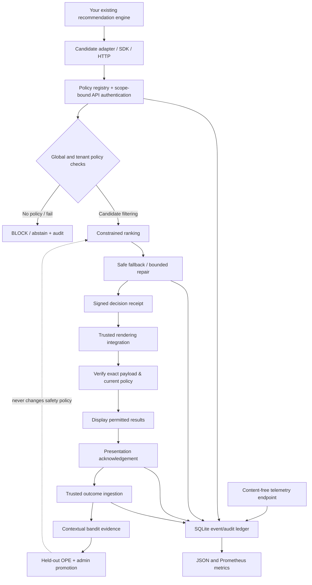

# RecGuard — portable recommendation-control kernel

**An independently deployable reference implementation (v0.2), not a production-certified platform.**

RecGuard runs **outside** the ranking model: any recommendation engine supplies ranked/scored candidate items; RecGuard enforces cross-cutting policies, repairs or abstains, and returns a verifiable recommendation package. An isolated, bounded learning loop can experiment between safe rerankers and propose evidence-gated promotion. Every output and governance change is audited. Logs and trusted outcomes enter through different, scoped endpoints.

## Design commitments

1. **Portable:** embed the Python library or use the JSON API from any language or algorithm. No dependency on Genie, LangGraph, MCP, or particular LLM/recommender.
2. **Fail closed:** no applicable policy → no recommendations. Serving-disabled tenant → no recommendations. A connectivity failure in a consuming SDK must never silently bypass RecGuard.
3. **Governance has precedence:** global and tenant policies compose with deny-overrides, AND-ed allowed regions and experiment consent, OR-ed mandatory checks, and restrictive min/max results. Learning cannot override policy.
4. **Repair without privilege escalation:** remove disallowed items, refill only with independently checked fallback items, then rerank; if hard minimum cannot be met, abstain/block.
5. **Audited, replayable control decisions:** store policy version fingerprint, reason codes and result hashes; HMAC receipts sign the *entire* result payload and expire after five minutes. Receipt verification invalidates outputs after policy changes or kill switch activation.
6. **Separate observed metrics from learning:** generic telemetry is restricted to typed content-free events. Only `outcomes:write` scoped trusted outcomes for actually acknowledged presentations influence the bandit.
7. **Controlled RL:** `OFF`, `SHADOW`, `EXPERIMENT`, `ACTIVE` state machine. `EXPERIMENT` uses explicit epsilon-greedy randomization among *already compliant* rerankers and records selection propensity. `ACTIVE` is possible only after explicit administrative promotion (or base strategy). Unsafe/high-impact policies always use the baseline.
8. **Realistic assurance:** promotion evaluation uses a held-out inverse-propensity comparison with effective-sample-size and lower confidence bound guards. It is a learning-demonstration gate, not an enterprise-valid causal claim.

## Architecture



## Install & test

Python 3.11+. The embeddable kernel depends only on Pydantic; the HTTP server is an optional extra.

```bash
pip install recguard-kernel            # embedded library only (pydantic)
pip install 'recguard-kernel[server]'  # + FastAPI/uvicorn HTTP API and `recguard serve`
python -m pip install -e '.[test,server]' && python -m pytest -q
python examples/embedded_demo.py
```

Command line (installed as `recguard`, or `python -m recguard`):

```bash
recguard dev-env --tenant demo      # throwaway local secrets (export lines)
recguard serve --port 8765          # HTTP API from RECGUARD_* environment
recguard audit acme --db recguard.db --expected-head <anchored-hash>   # exit 1 if tampered
```

Startup fails if tokens or signing keys are missing. A persistent embedded database also requires a stable explicit signing key to preserve audit and receipt integrity across restarts. For local API use:

```bash
# Docker (no local Python packages needed): writes a gitignored .env that Compose reads
python3 scripts/dev_env.py --env-file .env
docker compose up --build          # http://127.0.0.1:8765 ; set RECGUARD_PORT=8766 in .env if 8765 is taken

# Or run directly (after pip install '.[server]')
eval "$(recguard dev-env)"         # export lines for LOCAL DEVELOPMENT ONLY
recguard serve --port 8765
```

The included Compose deployment is **local-only** (binds `127.0.0.1`, one worker, SQLite volume, dropped Linux capabilities, read-only container root). It is not configured for public HTTPS exposure or high availability.

**Do not use generated local demo tokens for any public deployment.** Put the service behind HTTPS/mTLS, use secrets management, and replace demo bearer-token lookup with an enterprise identity provider and per-tenant service credentials.

## Algorithm-independent candidate contract

Your recommender can be rules, collaborative filtering, hybrid EASE, gradient-boosted ranking, embeddings, bandits, LLMs, or any third-party API. It only needs to return data shaped like:

```json
{
  "tenant_id": "acme",
  "request_id": "opaque-123",
  "purpose": "shopping",
  "segment": "new-user",
  "region": "IN",
  "personalization_consent": false,
  "k": 2,
  "candidates": [
    {"item_id":"sku-12","tenant_id":"acme","score":0.94,"categories":["electronics"],"evidence_ids":["catalog-v6"],"available":true,"uses_personal_data":false},
    {"item_id":"sku-44","tenant_id":"acme","score":0.91,"categories":["restricted"],"evidence_ids":["catalog-v6"]}
  ],
  "fallback_candidates": [
    {"item_id":"sku-78","tenant_id":"acme","score":0.75,"categories":["electronics"],"evidence_ids":["catalog-v6"]}
  ]
}
```

The returned `status` is `PASS` (ranked/truncated only), `REPAIRED` (items removed, de-duplicated, capped or back-filled), or `BLOCKED`. `rejections` lists every dropped item with its reason, so integrators can debug policy without guessing. Results include an HMAC receipt with TTL, `policy_fingerprint`, selected strategy, logged action propensity, and reason codes. No unfiltered candidates should be exposed by the host after processing. `evidence_ids` are *references*, not proof of independent verification; provenance ingestion and trust attestation are future integrations.

### Policy rules

Policies compose across global (`tenant_id: null`) and tenant scope; the strictest value always wins.

| Field | Composition | Effect |
|---|---|---|
| `denied_categories`, `denied_item_ids` | union | Never serve these |
| `allowed_categories` | intersection | Items need at least one allowed category |
| `allowed_regions` | intersection | Request region must be allowed |
| `require_evidence`, `require_consent_for_personalization` | any | Mandatory checks |
| `min_score` | max | Drop low-confidence candidates |
| `max_per_category` | min | Exposure/diversity cap per category |
| `min_results` / `max_results` | max / min | Abstain below the minimum |
| `allow_experiment` / `high_impact` | all / any | Gate the bandit |
| `purposes` | — | Empty = applies to every purpose |

`engine.effective_policy(tenant, purpose)` (or `GET /v1/policies/{tenant}?purpose=`) returns the composed result and its fingerprint.

### Plug-ins: custom checks and rerankers

```python
engine.register_check("stock", lambda item, req: None if inventory[item.item_id] else "OUT_OF_STOCK")
engine.register_strategy("margin", lambda items, k: sorted(items, key=lambda x: -margin[x.item_id]))
```

Checks are AND-ed with policy, can only remove items, fail closed if they raise, and are part of the policy fingerprint (registering one invalidates outstanding receipts). Strategies receive copies of eligible items and their output is validated as a duplicate-free subset — a reranker can reorder or drop, never inject or modify. Registered strategies join the bandit as arms (`explore=False` to opt out) and can be promoted through the same evidence gate.

### Embedded Python SDK

```python
from recguard import RecGuard, Candidate, Policy, Request

engine = RecGuard("recguard.db", signing_key=b"replace-this-with-random-key-of-32-or-more-bytes")
engine.register_policy(Policy(policy_id="corporate", version=1,
    denied_categories=["restricted"], require_evidence=True))

candidates = [Candidate(item_id="product-1", tenant_id="acme",
                        score=0.9, evidence_ids=["trusted-catalog-v1"])]
request = Request(tenant_id="acme", request_id="opaque-r1", purpose="shopping",
                  candidates=candidates, k=1)
result = engine.evaluate(request)
assert result.status != "BLOCKED"
assert engine.verify("acme", result.decision_id, result.receipt, result.results)
# Display result.results only; then call engine.presented(...), ideally in a trusted host.
```

Wrap any existing recommender function in one line, embedded or over HTTP:

```python
from recguard import guard_local, RecGuardClient, wrap_recommender
recommend = guard_local(engine, my_model.top_items, tenant_id="acme", purpose="shopping", k=5)
recommend = wrap_recommender(my_model.top_items, RecGuardClient(url, serve_token), "acme", "shopping", k=5)
```

Both raise `RecGuardError` (a `PermissionError`) on block, verification failure, HTTP error or unreachable service — the host fails closed.

### Multi-language REST API

A TypeScript caller is included in `examples/node_client.mjs`. Native client implementations only need to call:

| Endpoint | Scope | Purpose |
|---|---|---|
| `POST /v1/policies` | `policy:write` | Add monotonic versioned policy |
| `POST /v1/system/serving` | `policy:write` | Enable/disable tenant serving; tenant `*` is the global kill switch |
| `GET /healthz` | none | Liveness (DB reachable) |
| `GET /v1/policies/{tenant_id}` | `policy:read` | Latest policies; `?purpose=` adds the composed effective policy |
| `POST /v1/recommendations/evaluate` | `recommend:serve` | Candidate filtering, safe ranking, repair |
| `POST /v1/recommendations/evaluate-batch` | `recommend:serve` | Up to 100 requests per call |
| `POST /v1/recommendations/verify` | `recommend:serve` | Verify exact payload, signature, TTL, live policy |
| `POST /v1/recommendations/presented` | `recommend:present` | Record verified presentation |
| `POST /v1/telemetry/events` | `telemetry:write` | Typed observability; cannot train learning |
| `POST /v1/outcomes` | `outcomes:write` | One authenticated, normalized reward per decision |
| `POST /v1/learning/mode` | `learning:admin` | OFF/SHADOW/EXPERIMENT/ACTIVE |
| `POST /v1/learning/assess` | `learning:admin` | Candidate off-policy evaluation |
| `POST /v1/learning/promote` | `learning:admin` | Evidence-gated promotion |
| `POST /v1/learning/rollback` | `learning:admin` | Return to base + OFF |
| `POST /v1/data/purge` | `data:admin` | Retention: delete decisions/events/outcomes older than N seconds (≥1h); audit kept |
| `GET /v1/metrics/{tenant_id}` | `metrics:read` | Decision/learning/operational scorecard |
| `GET /v1/metrics/{tenant_id}/prometheus` | `metrics:read` | Minimal Prometheus exposition |
| `GET /v1/audit/{tenant_id}/verify` | `audit:read` | Recompute audit-chain integrity; `?expected_head=` detects tail deletion |
| `GET /v1/audit/{tenant_id}/head` | `audit:read` | Current chain head — anchor it externally |

Tokens are opaque; `RECGUARD_TOKENS_JSON` maps each bearer token to its tenant and scopes. The global-policy token belongs to tenant `*`; a service token for `acme` cannot read/write `other` tenant's data.

### Recommended real-world integration order

**1 — Genie:** adapt `backend/app/analytics/recsys.py` candidates through this control layer. Do not change EASE, content scoring, popularity, or existing holdout evaluation. Have Genie's trusted backend verify/present before displaying recommendations.

**2 — Model-Autopilot/model-zoo:** adapt recommended model/experiment choices as candidates; constrain allowable model families, budgets and available evidence. Introduce purpose-specific policies for statistical validity.

**3 — VCAF:** use as a *synthetic simulation testbed* for ranking strategies, not a substitute for measured human preferences or business outcomes.

**4 — Governix:** govern policy reviews and signatures and serve as the human approval workflow; use `hunter-pack` for OTel/Datadog/Grafana forwarding.

## RL behavior and feedback trust

- **OFF:** deterministic baseline (`base`) only.
- **SHADOW:** deterministic baseline serving with logged trusted outcomes. Counterfactual outcomes for other strategies are *not inferred*; there is no hidden exploration.
- **EXPERIMENT:** `base`, `diverse` and `novelty` rerankers are sampled by an epsilon-greedy contextual bandit (`segment`-scoped). Only when all effective policies allow exploration and no high-impact flag is set. The logged propensity supports offline evaluation.
- **ACTIVE:** approved strategy runs deterministically; policy checks remain active on every request. Rollback sets base/OFF.

The selection strategy **never** changes denied categories, consent, age restrictions, tenant isolation, minimum evidence, scope policy, or output authorization. Promoted strategies are rerankers only, not arbitrary generated code.

Outcome events (`reward ∈ [0,1]`) may come **only** from your authenticated server, after a verified presentation. Do not send raw clicks from browser clients to this endpoint. Avoid naive implicit-feedback rewards: clicks do not guarantee relevance, satisfaction or incremental business value. Define business rewards in a versioned evaluation profile upstream; this starter assumes the value is already normalized.

The sample promotion test uses 50% stable holdout IPS bootstrap, >=100 rewarded holdout decisions and effective sample size >=20 for each compared arm. **Production improvements required:** randomized prospective epoch locks, separate policy-version cohorts, multiple-comparison control, delayed-outcome windows, overlapping support checks by segment, independent holdout governance, confidence sequences, and bias checks for missing rewards. No proof of causal superiority is claimed.

## Observability scorecard

`GET /v1/metrics/{tenant_id}` provides:

| Dimension | Current numeric metrics | Key interpretation |
|---|---|---|
| Safety | block rate, repair rate, eligibility rate | Did rule enforcement actually constrain the recommendations? |
| Reliability | signed presentation counts, audit validity | Did a trusted host acknowledge exactly what was approved? |
| User response | observed CTR, conversion per presentation | Diagnostic only; not causal lift |
| Learning | logged propensities, mean normalized outcome reward, strategy counts, OPE estimate/ESS | Is exploration safe and the learned policy supported? |
| Performance | p50/p95 logged latency, token count, logged cost USD | Infrastructure health; latency must be emitted by a trusted integration |
| Governance | policy version hashes, reason codes, mode changes, promotion/rollback audit | Why was each decision accepted, repaired, blocked, or altered? |

Event, outcome and policy IDs are scoped per tenant; tenants cannot collide on or probe each other's IDs. Databases created by v0.1 are migrated in place on first open.

Telemetry accepts only structured `event_id`, `tenant_id`, event type, optional decision ID, latency, tokens and cost. Arbitrary context, raw user IDs, prompts, recommendation descriptions, or other free text are **schema-rejected**. Wire OpenTelemetry exporters separately; the exposed `/prometheus` endpoint is a minimal metric bridge, not a full OTel collector.

## Threats, known limitations, and boundaries

- **Enforcement placement:** You cannot force an untrusted application to call RecGuard. Only a trusted host-side integration or controlled egress gateway can enforce the decision; display clients can bypass it otherwise. Treat rendered acknowledgement as an attested host event, not proof a human actually viewed the content.
- **Incomplete policy inputs:** Candidate metadata and declared consent/evidence may be false. Production needs signed catalog attributes, age/consent verification, data lineage and independent validation of upstream features/algorithms.
- **Tenancy:** Tenant-scoped API tokens and DB filtering are in place; production requires dedicated schema/db-level RLS and adversarial multi-tenant audits. One tenant with many policies and purposes requires purpose-specific learning cohorts, not global tenant aggregation.
- **SQLite:** single-node demonstration. Migrate to Postgres with atomic transactions, RLS, migrations, outbox/idempotency and reliable distributed locking for multi-pod service.
- **Audit:** HMAC hash-chain catches row tampering in retained records. Tail deletion is detected only when you periodically store `GET /v1/audit/{tenant}/head` somewhere immutable and pass it back as `expected_head`. Secret theft compromises chain integrity.
- **Reward quality:** the service authenticates the trusted sender; it cannot prove that the sender's normalized rewards are unbiased or causal. Delayed and missing rewards can distort metrics and OPE.
- **Ranking quality:** numeric scores are assumed to be comparable within one request. Diversity and novelty weights are demonstration choices, not tuned market constants.
- **Policy changes:** receipts invalidate when policy fingerprints change and during kill-switch. Full enforcement after display requires downstream ongoing controls.
- **Runtime:** API bearer authentication is simple, not a substitute for enterprise IAM, OAuth/OIDC, mTLS, rate limiting, TLS termination or DDoS defense.
- **PII:** request `subject_ref` is never persisted by the kernel, but upstream must provide only pseudonymous values for request IDs, item IDs and coarse segments. Configure application/server logging to avoid printing payloads.
- **Retention:** `purge` / `POST /v1/data/purge` deletes operational rows on demand; schedule it (cron, k8s CronJob) to match your privacy policy. The audit chain is retained.

### Suggested next pieces (beyond current weekend starter)

1. Pydantic policy-as-code compiler (OPA/Rego/Cedar interoperability) + property-based invariants.
2. External governance service and signed policy bundles with approvals and staged rollout.
3. Full Postgres durability, retention, tenant-level security, Kubernetes deployment and distributed rate limiting.
4. Trusted exposure and business-outcome attribution layer, exploration propensity validity, off-policy audits per purpose/version.
5. Model-independent adapters for TensorFlow Ranking, implicit/LightFM, sklearn, XGBoost, TorchRec, Feast, Redis and SaaS recommendation providers.
6. Richer evaluation profiles: NDCG@k from labeled offline sets, calibration, catalog coverage, exposure diversity, fairness constraints, novelty, conversion, margin, uplift, ROI and drift detection.

## Development quality statement

Tests cover safety and boundary scenarios using synthetic data. This project intentionally does **not** claim current production readiness, comprehensive authorization proofs, unbiased RL improvements, independent catalog verification, or cross-process fault tolerance.
